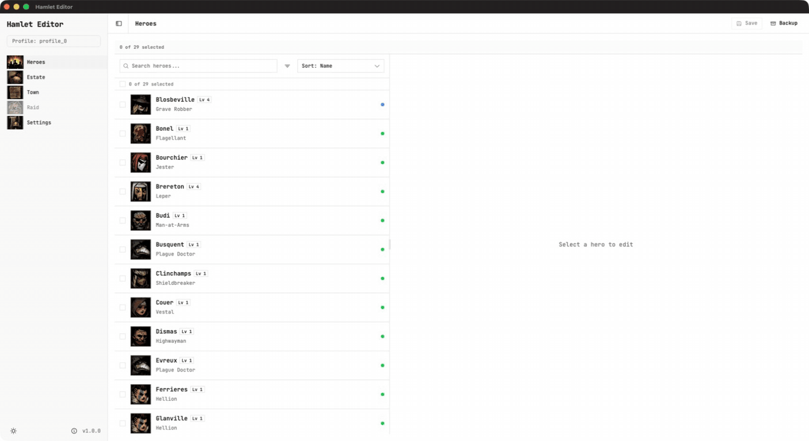
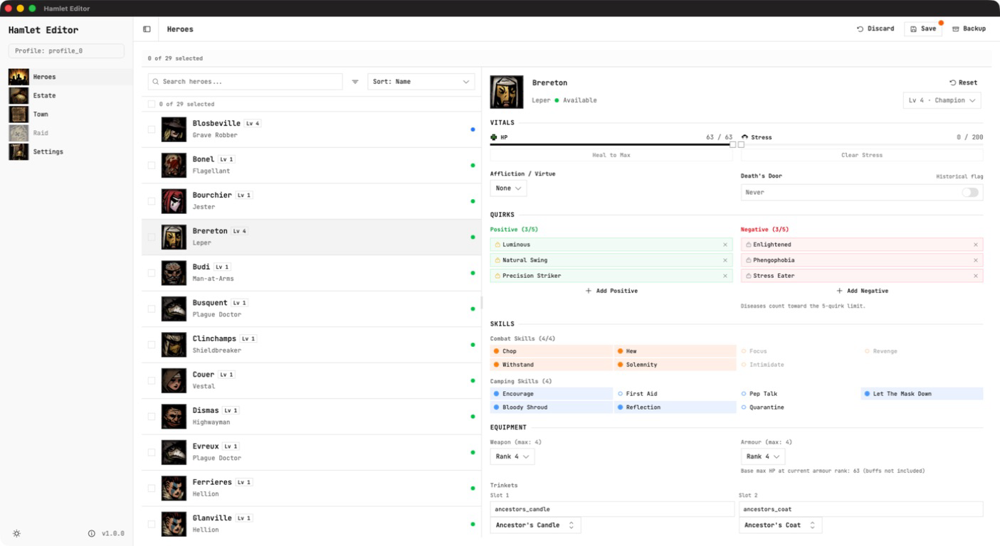
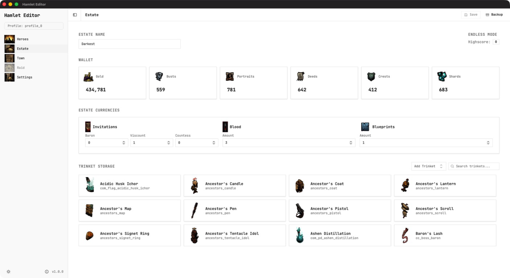
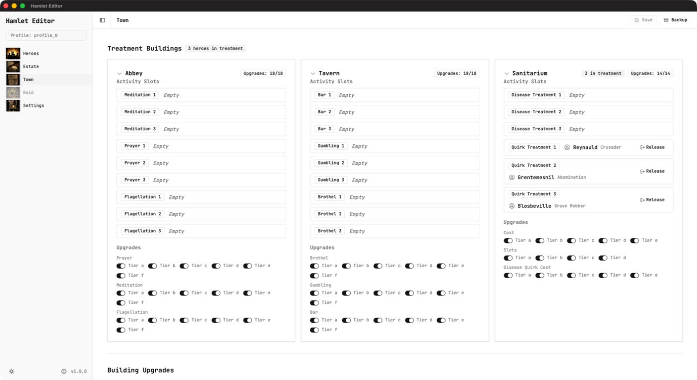

<div align="center">

# Hamlet Editor

A save editor for Darkest Dungeon. Edit your heroes, estate, town and raids, with backups and safety checks built in.

[](https://github.com/zendevio/hamlet-editor/actions/workflows/ci.yml) [](https://github.com/zendevio/hamlet-editor/releases) [](https://github.com/zendevio/hamlet-editor/releases/latest) [](LICENSE) [](#download)



[Download](#download) · [Features](#features) · [Build from source](#build-from-source)

</div>

<details>
<summary><b>Screenshots</b> (click to expand)</summary>
<br>
<table>
  <tr>
    <td colspan="2"><a href="docs/media/heroes.png"></a></td>
  </tr>
  <tr>
    <td colspan="2" align="center">Heroes</td>
  </tr>
  <tr>
    <td><a href="docs/media/estate.png"></a></td>
    <td><a href="docs/media/town.png"></a></td>
  </tr>
  <tr>
    <td align="center">Estate</td>
    <td align="center">Town</td>
  </tr>
</table>
</details>

## Features

- **Heroes:** HP, stress, level, quirks, diseases, skills, gear and trinkets. Edit several heroes at once, or revive a fallen hero in town.
- **Estate:** gold, heirlooms, invitations, blood, blueprints and the trinket inventory. Equipping a trinket moves it out of your inventory, just like in the game.
- **Town:** building upgrades and the heroes in treatment.
- **Raid:** torchlight, hunger, party order and supplies of an active expedition. Abandon an expedition and return the party to town.
- **Backups:** a backup before every save (optional), plus manual backups and one-click restore.
- **Finds your game:** detects Steam and GOG installs and save folders on all three platforms, with multiple profiles.

## Save safety

Your campaign matters, so the editor is careful with it:

- A save writes all files or none. If anything fails, nothing is changed.
- Saving is blocked while Darkest Dungeon is running.
- If the game changed your save after you opened it, the editor asks you to reload instead of overwriting the newer save.
- Edits are checked before they are written, so values the game cannot read are rejected.
- Every restore makes a safety backup of your current save first.

Still, keep your own copy of the save folder before you start.

## Download

Get the latest version from the [Releases page](https://github.com/zendevio/hamlet-editor/releases/latest).

| System | File |
| --- | --- |
| Windows 10/11 | `...windows_x64-setup.exe` (or `.msi`) |
| macOS 11 or later | `...darwin_universal.dmg` (Intel and Apple Silicon) |
| Linux | `.AppImage`, `.deb` or `.rpm` |

The builds are free and not signed with a paid certificate, so your system will warn you the first time. Open the section for your system:

<details>
<summary><b>Windows</b></summary>

- Your browser may say the file is not commonly downloaded. Choose **Keep** (in Edge: **... > Keep > Show more > Keep anyway**).
- If **Windows protected your PC** appears, click **More info**, then **Run anyway**.
- If Smart App Control is turned on, Windows 11 blocks unsigned installers and there is no way to allow just this one.
- The installer downloads WebView2 if your system does not have it yet.

</details>

<details>
<summary><b>macOS</b></summary>

1. Open the `.dmg` and drag **Hamlet Editor** to Applications.
2. Open the app once. When macOS says it cannot verify the developer, click **Done** or **OK**.
3. Go to **System Settings > Privacy & Security**, scroll down and click **Open Anyway** next to Hamlet Editor, then click **Open**. (On macOS 11 or 12: **System Preferences > Security & Privacy > General**.)
4. If macOS says the app **is damaged and can't be opened**, run this in Terminal and try again:

   ```sh
   xattr -dr com.apple.quarantine "/Applications/Hamlet Editor.app"
   ```

</details>

<details>
<summary><b>Linux</b></summary>

- **AppImage:** `chmod +x hamlet-editor_*.AppImage`, then run it. On Ubuntu 24.04 or later, install FUSE first: `sudo apt install libfuse2t64`.
- **Debian / Ubuntu:** `sudo apt install ./hamlet-editor_*.deb`
- **Fedora:** `sudo dnf install ./hamlet-editor_*.rpm`
- **Blank window** on NVIDIA or Wayland: start it with `WEBKIT_DISABLE_DMABUF_RENDERER=1`.
- **Steam Deck:** use the AppImage in Desktop Mode.

</details>

## Getting started

1. Close Darkest Dungeon.
2. Back up your save folder:
   - **Steam:** `<Steam folder>/userdata/<your id>/262060/remote/profile_<n>`
   - **GOG on Windows:** `Documents\Darkest`
   - **GOG on macOS:** `~/Library/Application Support/Darkest`
   - **GOG on Linux:** `~/.local/share/Red Hook Studios/Darkest`
3. Open Hamlet Editor. It finds your game and saves, or asks you to pick the folders.
4. Edit, press **Save**, then start the game.

### Steam Cloud

Steam Cloud can overwrite your edited save with the cloud copy. Before editing, turn it off for Darkest Dungeon (**Library > right-click Darkest Dungeon > Properties > General > Keep game saves in the Steam Cloud**), or quit Steam while you edit.

When you restore a backup that adds or removes save files, quit Steam completely first. Otherwise the game may refuse to load the campaign until Steam restarts. The editor tells you when this applies.

## Compatibility

- Tested on macOS with the base game plus The Crimson Court and The Shieldbreaker DLCs.
- Windows and Linux builds are made by the same code, but have not been tested by hand yet. Reports are welcome as [issues](https://github.com/zendevio/hamlet-editor/issues).
- Modded campaigns load and save. A few features, such as revival, are turned off for them because mods can change the rules.

## Build from source

You need [Node.js](https://nodejs.org) 24, [pnpm](https://pnpm.io) 12, [Rust](https://rustup.rs) (the version in `src-tauri/rust-toolchain.toml` is installed automatically) and the [Tauri prerequisites](https://tauri.app/start/prerequisites/) for your system.

```sh
pnpm install
pnpm tauri dev      # run in development
pnpm tauri build    # build an installer for your system
```

Run the tests:

```sh
pnpm test
cd src-tauri && cargo test --all-features && cargo test -p ddsavelib
```

Before a release, the checks in [docs/e2e-checklist.md](docs/e2e-checklist.md) are run against the real game.

## AI usage

I built Hamlet Editor with AI coding assistants. Every design decision was mine to make and review.

- **Building the editor:** Claude Code for researching the save format and the game's data, and for drafting source, tests and documentation from my design decisions.
- **Testing and hardening for 1.0:** Claude Code coordinated the work, OpenAI Codex implemented fixes and reviewed each change independently, and a Codex agent with computer use played the real game to check that edited saves load, including hero deaths, retreats and backup restores. My campaign was backed up before testing and restored after every run.
- **Release:** build setup, license review, this README and its screenshots, with the same tools.

The save format work builds on robojumper's open-source editor (see Credits).

## Credits

- [robojumper](https://github.com/robojumper) for [DarkestDungeonSaveEditor](https://github.com/robojumper/DarkestDungeonSaveEditor) and its Rust save library, which Hamlet Editor includes in a modified form, and for documenting the save format (MIT).
- Built with [Tauri](https://tauri.app), [SvelteKit](https://svelte.dev), [bits-ui](https://bits-ui.com), [shadcn-svelte](https://shadcn-svelte.com), [Phosphor Icons](https://phosphoricons.com) and the [JetBrains Mono](https://www.jetbrains.com/lp/mono/) font.
- Full license texts: [THIRD_PARTY_NOTICES.md](THIRD_PARTY_NOTICES.md) and [THIRD_PARTY_LICENSES.md](THIRD_PARTY_LICENSES.md).

Hamlet Editor is an unofficial fan tool. It is not affiliated with or endorsed by Red Hook Studios. Darkest Dungeon is a registered trademark of Red Hook Studios Inc.

## License

[MIT](LICENSE)
